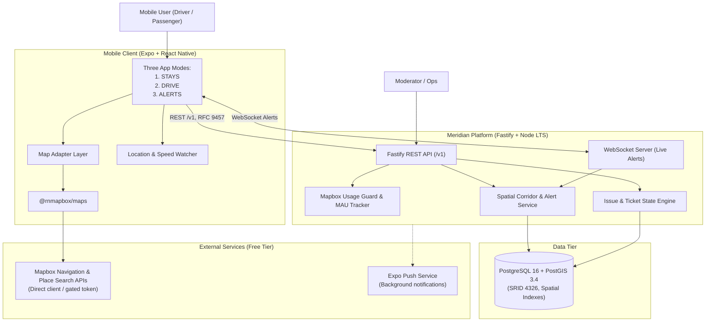

# Meridian Architecture: Overview

## 1. Context Diagram

## 2. The Three Application Modes

### Mode 1: STAYS
- **Purpose:** Discover lodging and accommodations along travel corridors and destinations.
- **Data Source:** Mapbox Place Search (category: `hotel`, `motel`, `lodging`).
- **No Deceptive Pricing:** Meridian displays place names, coordinates, ratings, and phone/address info with a direct external link to the hotel's official website or a plain search link. Zero scraped prices or fake booking forms. Affiliate rates will only appear after legitimate booking platform affiliate agreements are established.

### Mode 2: DRIVE
- **Purpose:** Car navigation and active hazard awareness.
- **Features:** Turn-by-turn routing powered by Mapbox Directions. Route line is registered ephemerally as a corridor session. Real-time proximity warnings alert the driver when approaching potholes, debris, or hazards along the travel corridor.

### Mode 3: ALERTS
- **Purpose:** Citizen and driver road issue reporting and crowdsourced hazard tracking.
- **Features:** Report potholes, road hazards, traffic obstacles, and signal failures.
- **Tracked Tickets:** Every valid report creates an in-app tracked ticket with a public audit timeline.
- **Universal Visibility:** Active reports are visible to all users browsing the map and automatically intersected with active navigation corridors.
