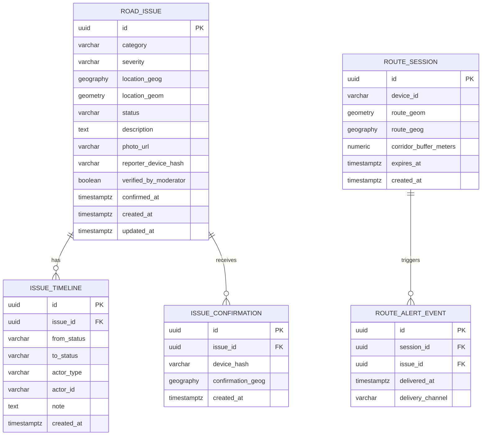

# Meridian Data Model

All spatial coordinates are stored in **SRID 4326** (WGS 84). All primary keys are UUIDv4 generated by the API. Timestamps are `timestamptz` in UTC.

## Entity Relationship Diagram

## Schema Definitions

### 1. `road_issues`
- `id`: UUID PRIMARY KEY
- `category`: VARCHAR(50) NOT NULL (e.g. `pothole`, `debris`, `flooding`, `signal_out`, `accident`, `roadwork`)
- `severity`: VARCHAR(20) NOT NULL (`low`, `medium`, `high`, `critical`)
- `location`: GEOMETRY(Point, 4326) NOT NULL (Indexed with GiST)
- `status`: VARCHAR(30) NOT NULL DEFAULT 'open' (`open`, `acknowledged`, `in_progress`, `resolved`, `rejected`, `duplicate`)
- `description`: TEXT NULL
- `photo_url`: VARCHAR(512) NULL (public URL; EXIF stripped)
- `reporter_device_hash`: VARCHAR(64) NOT NULL (salted SHA-256 hash of device identifier)
- `confirmations_count`: INTEGER NOT NULL DEFAULT 1
- `verified_by_moderator`: BOOLEAN NOT NULL DEFAULT FALSE
- `created_at`: TIMESTAMPTZ NOT NULL DEFAULT NOW()
- `updated_at`: TIMESTAMPTZ NOT NULL DEFAULT NOW()

### 2. `issue_timeline`
- `id`: UUID PRIMARY KEY
- `issue_id`: UUID NOT NULL REFERENCES `road_issues(id)` ON DELETE CASCADE
- `from_status`: VARCHAR(30) NOT NULL
- `to_status`: VARCHAR(30) NOT NULL
- `actor_type`: VARCHAR(30) NOT NULL (`reporter`, `system_dedupe`, `moderator`, `user_confirmation`)
- `actor_id`: VARCHAR(64) NOT NULL
- `note`: TEXT NULL
- `created_at`: TIMESTAMPTZ NOT NULL DEFAULT NOW()

### 3. `route_sessions`
- `id`: UUID PRIMARY KEY
- `device_id`: VARCHAR(64) NOT NULL
- `route_line`: GEOMETRY(LineString, 4326) NOT NULL (Indexed with GiST)
- `corridor_buffer_meters`: DOUBLE PRECISION NOT NULL DEFAULT 250.0
- `expires_at`: TIMESTAMPTZ NOT NULL (Indexed for purge sweeps)
- `created_at`: TIMESTAMPTZ NOT NULL DEFAULT NOW()

## Indexes & Constraints
- `idx_road_issues_location`: GiST (`location`)
- `idx_road_issues_status_category`: B-Tree (`status`, `category`)
- `idx_route_sessions_route_line`: GiST (`route_line`)
- `idx_route_sessions_expires_at`: B-Tree (`expires_at`)
- `idx_issue_timeline_issue_id`: B-Tree (`issue_id`, `created_at`)
