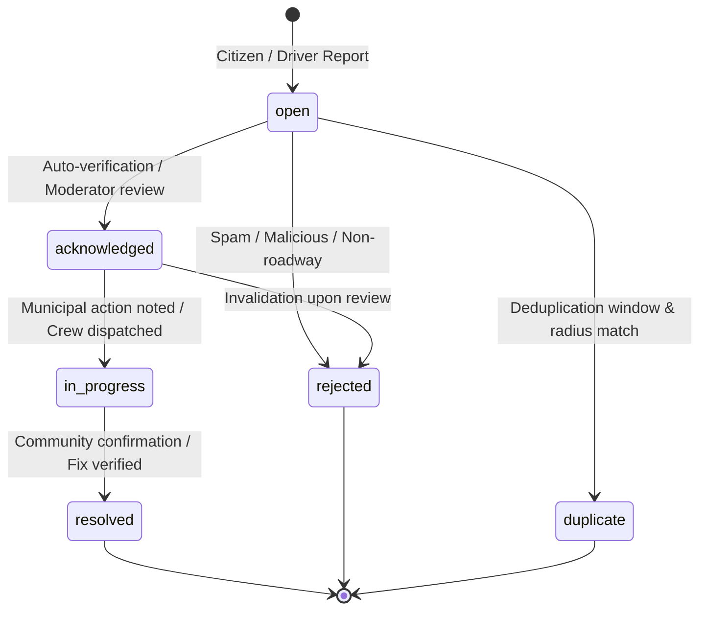

# Road Issues and In-App Tickets Architecture

## 1. Issue Lifecycle State Machine



### State Transitions and Permissions

| From State | To State | Trigger / Actor | Rules & Validation |
| :--- | :--- | :--- | :--- |
| `[*]` | `open` | Mobile User | Speed check passed; coordinates valid WGS 84 point; category in supported list |
| `open` | `duplicate` | System Dedupe Engine | Same category within `DEDUPE_RADIUS_METERS` (default: 40m) and `DEDUPE_WINDOW_HOURS` (default: 72h). Increments parent `confirmations_count`. |
| `open` | `acknowledged` | Moderator / Threshold | Reaches 3+ unique device confirmations OR moderator review. |
| `acknowledged`| `in_progress` | Moderator | Authority note added or field inspection recorded. |
| `in_progress` | `resolved` | Community / Moderator | 3+ "Cleared" confirmations from passing drivers OR moderator sign-off. |
| `open` | `rejected` | Moderator / Abuse Filter | Fails photo content check, off-road coordinates, or rate limit abuse. |

## 2. In-App Tracked Ticket Concept
Every road issue filed generates a tracked ticket number (e.g. `TKT-2026-XXXX`).
- A ticket is **an internal in-app audit trail**, providing transparency to all users.
- Every state change logs an immutable entry in `issue_timeline`:
  - `actor_type`: `reporter`, `system_dedupe`, `moderator`, `user_confirmation`
  - `actor_id`: Masked ID of the actor
  - `created_at`: UTC timestamp
  - `note`: Operational message
- It is NOT an official city/state public works submission unless an explicit authority dispatch webhook is activated.

## 3. Deduplication Algorithm
When a report arrives at `POST /v1/issues`:
1. Execute PostGIS query:
   ```sql
   SELECT id, confirmations_count
   FROM road_issues
   WHERE category = $1
     AND status IN ('open', 'acknowledged', 'in_progress')
     AND ST_DWithin(location, ST_SetSRID(ST_MakePoint($2, $3), 4326)::geography, $4)
     AND created_at > NOW() - INTERVAL '72 HOURS'
   ORDER BY location <-> ST_SetSRID(ST_MakePoint($2, $3), 4326)
   LIMIT 1;
   ```
2. If match found:
   - Attach new report as confirmation in `issue_confirmations`.
   - Increment `confirmations_count` on parent issue.
   - Record timeline entry: "Confirmed by nearby user report".
   - Return 200 OK with parent ticket ID and deduplicated flag.
3. If no match found:
   - Insert new row into `road_issues` with status `open`.

## 4. Staleness Rules
- Potholes and road degradation: stale after 30 days without confirmation.
- Temporary hazards (debris, accident, flooding): stale after 12 hours without confirmation.
- Stale issues transition to `resolved` or archived automatically by a scheduled maintenance sweep.
