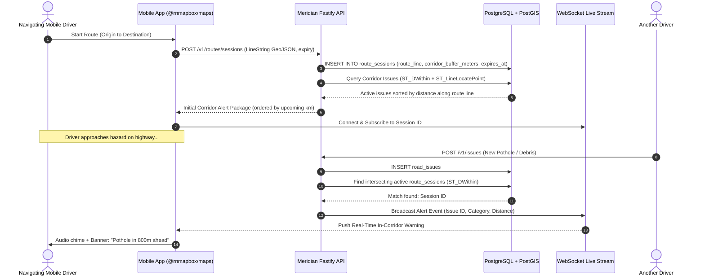

# Route Alerts & Spatial Corridor Engine

## 1. High-Level Spatial Flow



## 2. Spatial Query Specifications

### Viewport Query (For General Map Browsing)
```sql
SELECT id, category, severity, status, confirmations_count, verified_by_moderator,
       ST_AsGeoJSON(location)::json AS location, created_at
FROM road_issues
WHERE status IN ('open', 'acknowledged', 'in_progress')
  AND location && ST_MakeEnvelope($minLng, $minLat, $maxLng, $maxLat, 4326);
```

### Route Corridor Intersect Query
When planning or driving a route, hazards are buffered within a configurable corridor (default: 250m) and sorted by linear reference along the route line:
```sql
SELECT 
    i.id,
    i.category,
    i.severity,
    i.confirmations_count,
    i.verified_by_moderator,
    ST_AsGeoJSON(i.location)::json AS location,
    ST_Distance(i.location::geography, $routeLine::geography) AS distance_from_route_meters,
    ST_LineLocatePoint($routeLine, i.location) AS progress_fraction
FROM road_issues i
WHERE i.status IN ('open', 'acknowledged', 'in_progress')
  AND ST_DWithin(i.location::geography, $routeLine::geography, $bufferMeters)
ORDER BY progress_fraction ASC;
```

### Matching New Reports to Active Sessions
```sql
SELECT s.id AS session_id, s.device_id
FROM route_sessions s
WHERE s.expires_at > NOW()
  AND ST_DWithin(s.route_line::geography, ST_SetSRID(ST_MakePoint($lng, $lat), 4326)::geography, s.corridor_buffer_meters);
```

## 3. Route Session Expiry & Retention
- A navigation session is ephemeral. Default TTL: `estimated_trip_duration + 30 minutes` (max 6 hours).
- A background sweep runs every 10 minutes to purge expired sessions:
  ```sql
  DELETE FROM route_sessions WHERE expires_at < NOW();
  ```
- No user identity or travel history is attached to route sessions.

## 4. UI Trust & Attribution
- Alerts display the **age** (e.g. "Reported 12m ago") and **confirmation count** ("Confirmed by 4 drivers").
- The word **"Verified"** appears ONLY if `verified_by_moderator = true`. Crowdsourced reports show "Community Confirmed".
